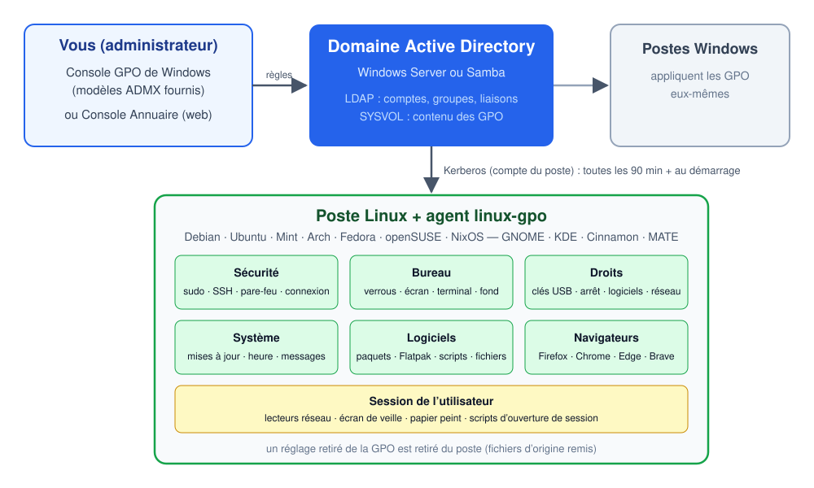
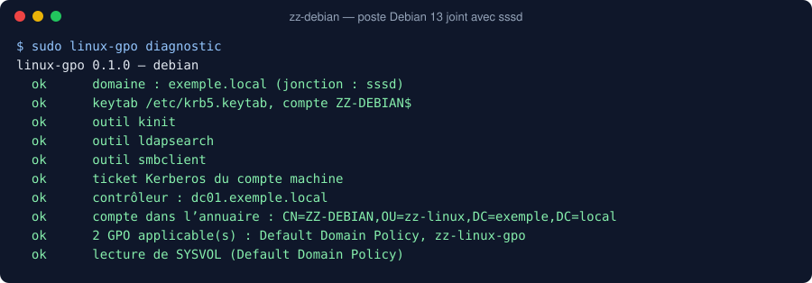
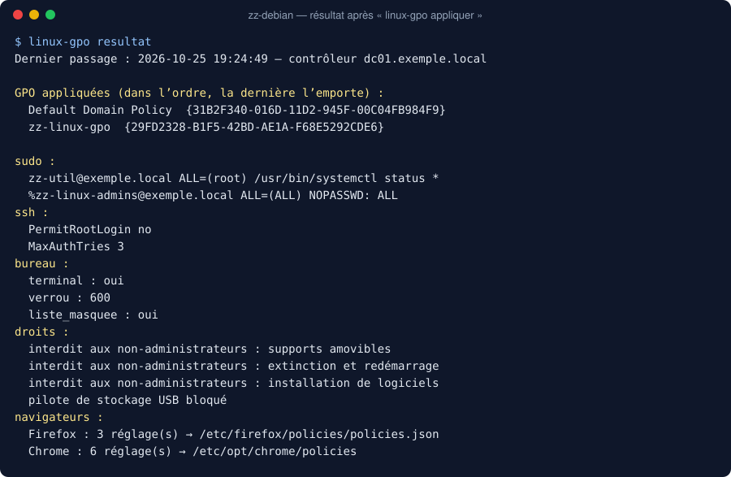

# linux-gpo

**Les stratégies de groupe (GPO) d’Active Directory, appliquées aux postes Linux comme aux postes Windows.**



## Pourquoi ce projet ?

Dans une entreprise, une école ou une administration, les postes sont gérés par **Active Directory** : on écrit
une règle une fois (« écran verrouillé après 10 minutes », « pas de clé USB », « le support peut faire sudo »…)
et tous les PC Windows l’appliquent tout seuls. C’est ce qui rend un parc de centaines de postes gérable.

Les postes **Linux**, eux, savent rejoindre le domaine (comptes et mots de passe communs), mais **ignorent les
GPO**. Résultat : chaque poste Linux se configure à la main, ou avec des outils à part (Ansible, Puppet…) que
l’équipe Windows ne connaît pas. C’est souvent ce qui empêche d’installer Linux dans un parc existant.

Les solutions existantes sont partielles : `samba-gpupdate` ne fonctionne qu’avec winbind (alors que la plupart
des postes sont joints avec sssd) et ne gère que GNOME ; les autres sont liées à une distribution (ALT Linux,
Ubuntu Pro avec ADsys).

**linux-gpo** comble ce manque : un seul agent, sans dépendance, pour toutes les distributions et tous les bureaux,
qui lit les GPO exactement comme Windows. L’administrateur continue de travailler dans ses outils habituels — la
console de gestion des stratégies de groupe de Windows ou la Console Annuaire (console web pour Samba AD) —
et ses postes Linux suivent les mêmes règles que les postes Windows.



Un poste Linux joint à un domaine (Windows Server ou Samba) reçoit les GPO qui le concernent, dans le même
ordre et avec les mêmes règles que Windows : liaisons au site, au domaine et aux unités d’organisation,
blocage de l’héritage, liaisons appliquées, filtrage de sécurité, GPO désactivées. Quand un réglage est retiré
de la GPO, le poste revient à son état d’origine.

- **Toutes les distributions** : Debian, Ubuntu, Linux Mint, Arch, Manjaro, Fedora, openSUSE, NixOS (module).
- **Tous les bureaux** : GNOME, KDE Plasma, Cinnamon, MATE, Budgie (et Xfce pour ce qui ne dépend pas du bureau).
- **Toutes les jonctions** : sssd (`realm join`, `adcli join`) ou winbind (`net ads join`).
- **Aucune dépendance Python** : seulement `kinit`, `ldapsearch` et `smbclient`, présents partout.
- **Réglable depuis Windows** : modèles ADMX fournis (français et anglais) pour la console de gestion des
  stratégies de groupe ; les réglages Windows qui ont un équivalent Linux sont aussi repris.

## Ce qui est appliqué

| Domaine | Réglages | Sous Linux |
|---|---|---|
| Sécurité | droits sudo | `/etc/sudoers.d`, chaque règle vérifiée par `visudo` |
| | qui peut ouvrir une session (autorisés / refusés) | module PAM ; root et comptes locaux jamais bloqués |
| | droits Windows « Permettre / Interdire l’ouverture de session locale » | idem (ou sssd s’il les applique déjà) |
| | serveur SSH | `sshd_config.d`, vérifié par `sshd -t` |
| | pare-feu | firewalld, ufw ou nftables selon le poste |
| Bureau | terminal interdit, impression, enregistrement, déconnexion, changement d’utilisateur | dconf verrouillé (GNOME, Cinnamon, MATE), KDE Kiosk |
| | verrouillage de l’écran après inactivité (et stratégie Windows équivalente) | idem |
| | image de fond, écran de connexion sans liste des utilisateurs, message de connexion | GDM, SDDM, LightDM |
| Droits | supports amovibles (et stratégie Windows « refuser tout accès »), arrêt, installation de logiciels, réseau | règles polkit, pilote USB bloqué |
| Système | mises à jour automatiques (et Windows Update) | unattended-upgrades, dnf, pacman, zypper |
| | heure synchronisée sur le domaine | systemd-timesyncd, chrony |
| | messages avant et après connexion (et message légal Windows) | `/etc/issue`, `/etc/motd` |
| | fichiers et liens à déployer | copiés depuis SYSVOL ou un partage |
| Logiciels | paquets à installer ou retirer, applications Flatpak | apt, pacman, dnf, zypper, flatpak |
| | scripts de démarrage, toutes les heures / jours / semaines / mois | minuteurs systemd |
| Navigateurs | toutes les stratégies Firefox, Chrome, Chromium, Edge, Brave (modèles ADMX officiels) | fichiers de stratégie JSON |
| Utilisateur | lecteurs réseau (préférences Windows) et dossier personnel (homeDirectory) | favoris GNOME et KDE, montage gio |
| Utilisateur | raccourcis (préférences Windows) : bureau, menu, démarrage | lanceurs .desktop (application installée, site web, partage) |
| | profils de bureau de la Console Annuaire : icônes, barre des tâches, applications | lanceurs, épingles Plasma / GNOME, Flathub (voir plus bas) |
| | écran de veille, papier peint, invite de commandes (stratégies Windows) | réglages de la session |
| | scripts d’ouverture de session | lancés dans la session |

Les formats de Samba (`samba-gpupdate` : sudo, scripts, firewalld, messages, fichiers VGP, GNOME) sont aussi lus :
un domaine déjà configuré pour `samba-gpupdate` fonctionne tel quel.

## Installation

Le poste doit être joint au domaine (`realm join exemple.local`, `adcli join` ou `net ads join`).

```bash
git clone https://github.com/jonathan-pp/linux-gpo-agent.git
cd linux-gpo-agent
sudo ./install.sh
```

Le script installe les dépendances, l’agent et ses minuteurs, vérifie la jonction (`linux-gpo diagnostic`) puis
applique les GPO une première fois. Paquets : `packaging/debian/construire-deb.sh` (.deb), `packaging/arch/PKGBUILD`.

**NixOS** :

```nix
{
  imports = [ "${builtins.fetchTarball "https://github.com/jonathan-pp/linux-gpo-agent/archive/main.tar.gz"}/packaging/nixos/module.nix" ];
  services.linux-gpo.enable = true;
}
```

(ou le flake : `nixosModules.default`). Sur NixOS, la configuration Nix reste maîtresse : paquets, mises à jour et
réglages SSH déjà définis dans la configuration ne sont pas modifiés par les GPO.

## Utilisation

| Commande | Rôle |
|---|---|
| `linux-gpo appliquer` | applique les GPO de l’ordinateur (au démarrage puis toutes les 90 ± 30 minutes) |
| `linux-gpo appliquer --simuler` | montre ce qui serait fait, sans rien modifier |
| `linux-gpo resultat` | GPO appliquées et réglages obtenus (comme `gpresult`) |
| `linux-gpo utilisateur` | GPO de l’utilisateur (lancé à l’ouverture de session) |
| `linux-gpo diagnostic` | vérifie domaine, keytab, Kerberos, LDAP, SYSVOL et outils |
| `linux-gpo retirer-tout` | retire tout ce que l’agent a posé |
| `gpupdate` (`/force`, `/target:user`…) | relance tout de suite les GPO, comme sous Windows |
| `sudo linux-gpo applications` | installe les applications des profils de bureau demandées par les sessions (service `linux-gpo-applications`) |
| `sudo gpupgrade` (ou `sudo linux-gpo maj`) | met l’agent à jour depuis la Console Annuaire du domaine (sinon GitHub) ; source choisie par `source_maj` dans `agent.conf` |



## Profils de bureau

Un profil de bureau (Console Annuaire › Profils de bureau) est une GPO qui contient `USER/LinuxGPO/bureau.json` :
icônes du bureau, épingles de la barre des tâches, applications et fond d’écran, pour les membres de groupes choisis.

- À l’ouverture de session, les applications déjà présentes (paquet, Snap ou Flatpak, reconnues par leur lanceur) sont
  posées sur le bureau et épinglées (Plasma, GNOME).
- Celles qui manquent sont demandées au service système `linux-gpo-applications`, qui les installe depuis Flathub pour
  tout le poste : il relit lui-même le profil dans SYSVOL, une session ne peut donc faire installer que des applications
  choisies par un administrateur. Elles apparaissent ensuite sur le bureau.
- Les épingles sont posées quand le profil change ; l’utilisateur peut ensuite les modifier (comme la disposition de la
  barre des tâches de Windows). Les icônes du bureau sont reposées à chaque passage et retirées avec le profil.
- Poste hors domaine : un profil posé dans `/etc/linux-gpo/bureau.json` (PXE Deploy le fait) s’applique à tous les
  comptes locaux ; `hors_domaine = oui` dans `agent.conf` évite de chercher un contrôleur.

## Régler les postes Linux depuis Windows

Copiez `admx/LinuxGPO.admx` et les dossiers `admx/fr-FR` et `admx/en-US` dans le magasin central
(`\\domaine\SYSVOL\domaine\Policies\PolicyDefinitions`). Une branche **Modèles d’administration › Linux
(linux-gpo)** apparaît dans l’éditeur de stratégie de groupe.

## Fonctionnement

1. Ticket Kerberos du compte de l’ordinateur (keytab créé par la jonction), dans un cache privé.
2. LDAP : compte, groupes (tokenGroups), conteneurs parents, liaisons (gPLink), site d’après les sous-réseaux,
   descripteurs de sécurité des GPO.
3. SYSVOL : copie locale des GPO applicables (seulement quand leur version change).
4. Fusion des valeurs dans l’ordre d’application, puis une extension par famille de réglages.
5. Chaque fichier posé est enregistré (`/var/lib/linux-gpo/etat.json`) avec une copie de l’original : un réglage
   qui disparaît de la GPO est retiré du poste.

Limites : les filtres WMI ne sont pas évaluables sous Linux (une GPO filtrée est ignorée, sauf
`filtres_wmi = ignorer` dans `/etc/linux-gpo/agent.conf`) ; le traitement en boucle de rappel (loopback) n’est pas
encore pris en charge ; l’interdiction du terminal est une barrière d’interface, comme sous Windows.

## Tests

```bash
python3 -m unittest discover -s tests
```

Les tests appliquent des GPO de test dans une racine temporaire (aucune modification du système), vérifient l’ordre
d’application, le filtrage de sécurité, le retour à l’état d’origine, et les formats Registry.pol et GptTmpl.inf.

## Licence

GPL-3.0-or-later. La liste des types de stratégies Chrome (`linux_gpo/chrome_types.py`) vient de Samba (GPL-3.0).
